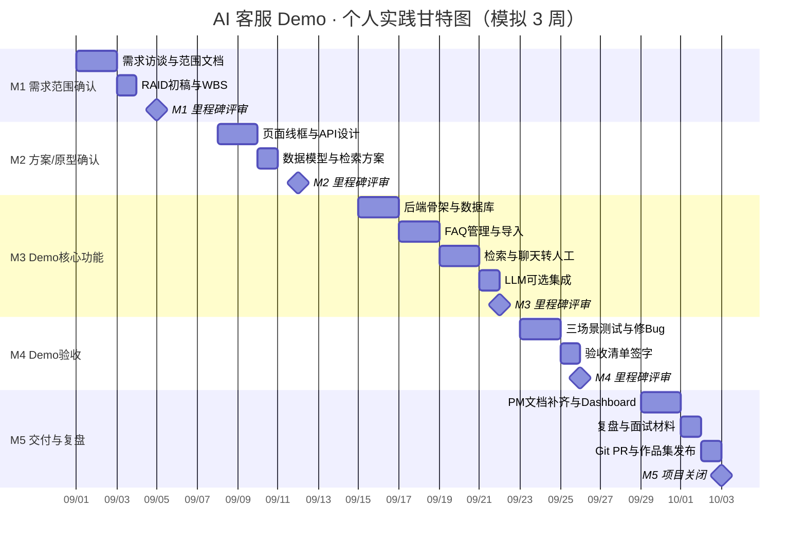

# 甘特图 · 模拟 3 周排期

> **标注**：以下为个人实践的模拟日历，非真实团队排期。

## 里程碑说明

| 里程碑 | 日期（模拟） | 完成标志 |
|--------|-------------|----------|
| **M1** 需求范围确认 | 09-05 | m1-scope.md 签字，6 条 US 冻结 |
| **M2** 方案/原型确认 | 09-12 | 左聊右管布局 + API 清单确认 |
| **M3** Demo核心完成 | 09-22 | 三场景代码可跑，种子 FAQ 可检索 |
| **M4** Demo验收完成 | 09-26 | 验收清单 3/3 通过 |
| **M5** 交付与复盘 | 10-03 | PR 合并，复盘 + 面试话术就绪 |
